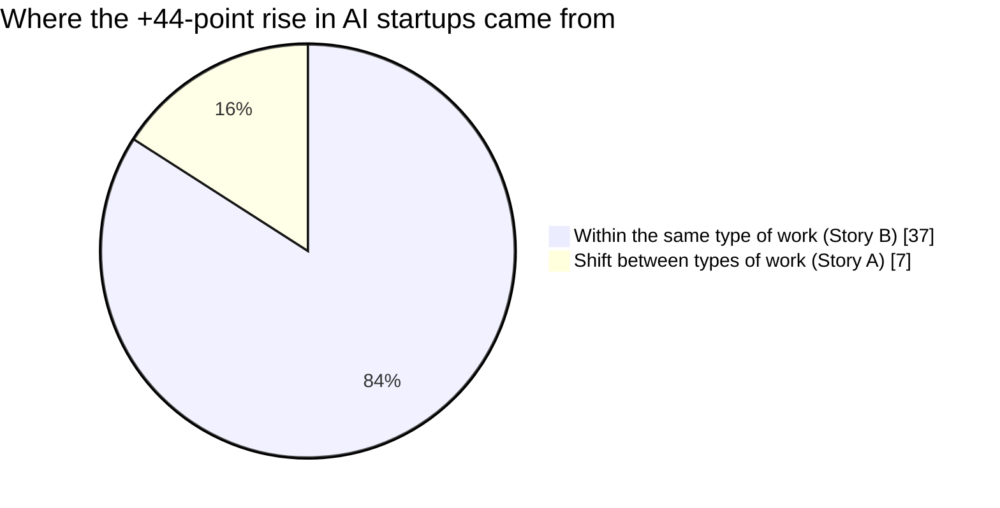

# Different work, or the same work with AI?
### What the AI boom changed in Y Combinator startups, 2017–2026

Since ChatGPT came out in late 2022, the share of new Y Combinator startups that have **AI at the core of their product** jumped from **25% to 69%**. But what does that rise actually mean?

- **Story A: different work.** New startups move into new markets (tools for AI agents instead of food delivery).
- **Story B: the same work with AI.** New startups enter the same markets as before (bookkeeping, healthcare, sales), but use AI to do the work.

Both stories produce the same rising line, so the headline number alone cannot tell them apart. This project separates them.

## Result

> **85% of the rise happened inside the same types of work.** Mostly Story B: AI is spreading into existing industries rather than creating a separate one, much like electricity did a century ago.

| | 2017–19 | 2023–26 |
|---|---|---|
| Startups with AI at the core | 25% | 69% |
| Rise explained *within* types | | **+37 points (85%)** |
| Rise explained *between* types | | +7 points (15%) |
| 95% bootstrap interval for the within share | | 80–89% |

AI grew in **every** type of work, and the biggest jumps were in established areas:

| Type of work | AI at the core, 2017–19 | AI at the core, 2023–26 |
|---|---|---|
| Finance and insurance | 11% | 53% |
| Healthcare and biotech | 24% | 71% |
| Media and education | 25% | 81% |
| Software development tools | 17% | 56% |
| Workflow automation | 35% | 87% |
| Data and ML infrastructure | 56% | 72% |

## Method: one big question, five smaller ones

No single model can answer "is this Story A or B?", so the question was broken into five smaller questions, each matched to the right tool:

| Step | Question | Tool | Why this tool |
|---|---|---|---|
| 1 | Is AI the core of this startup? | Decision model (`d3:2b`) | Fast yes/no with a probability, no labels needed |
| 2 | What work does it really do? | Small LLM (`gemma4:e2b`) + Pydantic schema | The only tool that writes text. Rewrites marketing as plain work, **with the word "AI" removed** |
| 3 | Which types of work exist? | BERTopic + human judgement | No list of categories existed. 18 topics merged by hand into 9 types |
| 4 | Which type is each of 5,560 startups? | Decision model (vs. a classifier) | Agreed more with our hand check (68% vs 50%) |
| 5 | How much of the rise is within types? | Shift-share decomposition | Pure counting, no AI needed |

AI status and type of work were measured **separately on purpose**. Otherwise the answer would have been built in from the start.

All models ran locally on a free Colab T4 GPU through Ollama. Total model time was about 25 minutes.

## Limitations

1. **Where to draw the line.** Is "AI agents for accountants" AI work or finance work? We classified by the work done, which pushes the result towards "within".
2. **Today's descriptions.** Older companies may have rewritten their descriptions to sound more like AI.
3. **AI as a fundraising label.** Some startups claim AI is their core because it helps them raise money.
4. **Number of types.** With 9 broad types, more of the rise looks like the same work. Narrower types would shift part of it to "between".
5. **YC selection.** The change may reflect what YC looks for, not only what founders want to build. Older firms that add AI never appear in new batches.

The bootstrap interval covers sampling noise only, not labelling errors.

## Tools and data

**Tools:** Python, pandas, scikit-learn, sentence-transformers, BERTopic, UMAP, HDBSCAN, Ollama, Pydantic, Google Colab
**Data:** public Y Combinator company directory via [yc-oss](https://github.com/yc-oss/api)

## Credits

Assignment for *Module 2: Intro to NLP*, MSc Business Data Science, Aalborg University Business School (2026).

